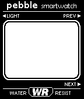

# Giant Pebble Smartwatch Wall Clock (91Dub Edition)

Transform a **Barnes & Noble Nook Simple Touch** (model `BNRV300`) into a wall-mounted digital clock modeled after the iconic **Pebble Smartwatch** running the classic **91Dub** watchface.



---

## Highlights

* **Authentic 91Dub Watchface:** Pixel-perfect recreation derived directly from the original Pebble C source code and 1-bit bitmap assets.
* **Pixel-Crisp E-Ink Scaling:** Pebble's native 144×168 canvas is integer-scaled 4× (576×672 px), centering cleanly onto the Nook's 600×800 6.0" Pearl E-Ink display with 0 subpixel blur.
* **100% Offline Single-File Dashboard:** `dashboard/index.html` embeds all 72 authentic PNG bitmaps as base64 data URIs. No WiFi connection or external CDN required—can run directly from `/sdcard/clock/index.html`.
* **Engineered for Android 2.1 (Eclair):** Written in strict ES3/ES5 vanilla JavaScript without modern ES6 or flexbox quirks, ensuring compatibility with legacy WebKit and Opera browsers.
* **E-Ink Pearl Optimizations:**
  * **Minute-aligned ticking:** Awakens on exact `:00` seconds in standard mode, keeping CPU wakeups to a minimum.
  * **Anti-ghosting waveform reset:** Built-in 200ms high-contrast flash cycles every 30 minutes (or on tap) to wipe residual e-ink particle shadows.
  * **Interactive touch zones:** Tap the top edge to open the settings drawer (12H/24H, Seconds, Blink, Invert, Pebble logo); tap the bottom edge to trigger a manual screen clear.
* **Parametric 3D Printable Pebble Case:** OpenSCAD CAD source (`cad/pebble_wall_clock.scad`) and pre-generated binary STLs (`cad/stls/`) designed to fit the Nook Simple Touch, with iconic Pebble curved bezels, side button caps, top/bottom strap lugs, micro-USB cable routing channel, and wall-mounting keyholes.

---

## Repository Structure

```
Bug91Dub/
├── README.md                      # Project master guide
├── dashboard/                     # 91Dub E-Ink Clock Web Dashboard
│   ├── index.html                 # 100% self-contained single-file clock (embedded assets)
│   ├── index.dev.html             # Development version linking external assets
│   ├── css/
│   │   └── style.css              # High-contrast e-ink layout & pixelated styling
│   ├── js/
│   │   └── clock.js               # ES3/ES5 clock engine (time, battery, invert, ghosting)
│   └── assets/
│       ├── embedded_assets.js     # Base64 data URI map of all 72 original assets
│       └── images/                # Authentic 144x168 Pebble 91Dub PNG images
├── cad/                           # 3D Print Enclosure & Mounts
│   ├── pebble_wall_clock.scad     # Parametric OpenSCAD source (front, rear, buttons, stand)
│   ├── generate_stls.py           # Zero-dependency Python script to export binary STLs
│   └── stls/                      # Pre-generated ready-to-slice STL models
│       ├── pebble_clock_front_bezel.stl
│       ├── pebble_clock_rear_mount.stl
│       ├── pebble_clock_button_caps.stl
│       └── pebble_clock_desk_stand.stl
├── nook_setup/                    # Nook Simple Touch configuration & scripts
│   ├── GUIDE.md                   # Comprehensive step-by-step rooting & setup guide
│   └── scripts/
│       ├── push_clock.sh          # One-click ADB transfer of clock to /sdcard/clock/
│       └── setup_adb.sh           # Display timeout and stay-awake configurator
└── server/                        # Optional local server hosting
    ├── server.py                  # Standalone Python HTTP server with e-ink no-cache headers
    └── docker-compose.yml         # Turnkey Docker Compose configuration for homelabs
```

---

## 3D Printing the Enclosure

The enclosure is styled after the original Pebble Classic smartwatch, scaled up to comfortably frame the 6.0" E-Ink Pearl screen while masking the Nook's frame and hardware "n" button.

### Components

| Part | File | Dimensions | Recommended Settings |
| :--- | :--- | :--- | :--- |
| **Front Bezel** | `cad/stls/pebble_clock_front_bezel.stl` | ~156 × 240 × 9 mm | 0.2mm layer height, 3 walls, 15% infill, face down on textured PEI |
| **Rear Mount** | `cad/stls/pebble_clock_rear_mount.stl` | ~156 × 240 × 15 mm | 0.2mm layer height, 4 walls, 20% infill, flat on back |
| **Button Caps** | `cad/stls/pebble_clock_button_caps.stl` | 4× button caps | 0.12–0.16mm layer height, accent color (silver/red) |
| **Desk Kickstand** | `cad/stls/pebble_clock_desk_stand.stl` | 71 × 85 × 18 mm | 0.2mm layer height, 4 walls, 25% infill |

> **Bed Size Fit:** The full chassis is ~156 mm wide × 240 mm tall (including the top/bottom strap lugs). It fits comfortably on standard 250×210 mm (Prusa MK3/MK4) and 256×256 mm (Bambu Lab P1/X1/A1) beds. For 220×220 mm beds (Ender 3), print diagonally or render the split halves (`split_front_top`, `split_front_bottom`) in OpenSCAD.

### Assembly
1. Place the Nook Simple Touch face-down into the rear mount's recessed cavity.
2. Plug in a low-profile right-angle micro-USB cable and guide the cord through the bottom channel or rear exit port.
3. Fit the side button caps into their respective side sockets.
4. Align the front bezel and secure the assembly with 4× M3 screws (12mm or 16mm button-head socket cap).
5. Hang on the wall using the dual keyhole slots or two strips of 3M Command Large Picture Hanging tape.

---

## Software Deployment

### Option A: Zero-Network Offline Mode (Recommended)
Because `dashboard/index.html` has no external dependencies, you can run it completely disconnected from the network:

1. Connect your rooted Nook via USB or ADB over WiFi.
2. Push the standalone file:
   ```bash
   ./nook_setup/scripts/push_clock.sh
   ```
3. Open `file:///sdcard/clock/index.html` in the Nook's full-screen browser.

### Option B: Local Network Server
Run the lightweight server on a Raspberry Pi or homelab server:

```bash
# Using Python
python3 server/server.py 8080

# Or using Docker
docker compose -f server/docker-compose.yml up -d
```

Navigate to `http://<SERVER_IP>:8080/` in the Nook's browser.

---

## Customizing the Clock

Tap the **top edge** of the screen to open the on-screen configuration panel:

* **12H / 24H:** Switches between 24-hour style and 12-hour style (with AM/PM indicator and suppressed leading zero).
* **Seconds:** Toggle between big bold time digits and medium digits + small ticking seconds.
* **Colon:** Choose between solid colon or 1-second blinking colon.
* **Theme:** Classic dark-on-light LCD vs. inverted high-contrast "Junkie Mode".
* **Pebble Logo:** Toggle the "pebble" branding placeholder on or off.
* **Clear Screen Now:** Instantly forces an e-ink waveform reset.

---

## License

MIT License. Designed and maintained by [orviwan](https://github.com/orviwan).
Original Pebble 91Dub watchface design and assets copyright orviwan.
