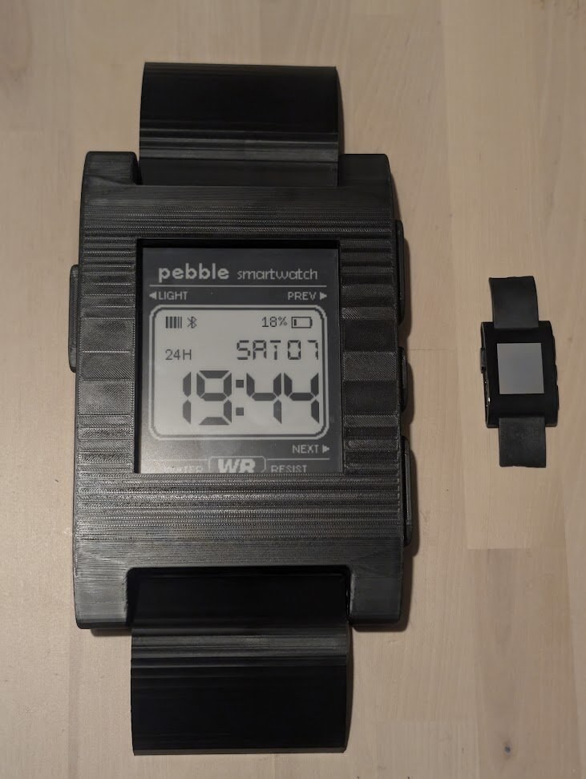
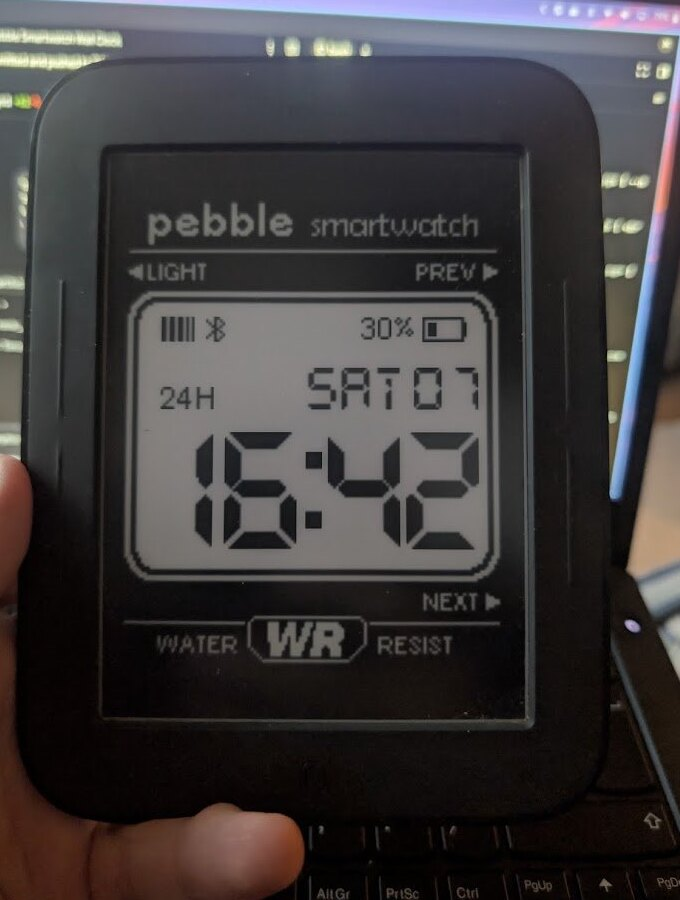

# Giant Pebble Classic Wall Clock (91Dub Edition)

Transform an unmodified **Barnes & Noble Nook Simple Touch** (model `BNRV300`, 6.0" E-Ink Pearl display) into a wall-mounted digital clock modeled after the iconic **Pebble Smartwatch** running the classic **91Dub** watchface (originally created by `orviwan`).

<p align="center">
  
  
</p>

---

## Highlights

* **Authentic Factory CAD Unibody:** Scaled directly from Pebble Technology Corporation's official 2013 factory CAD release (`PebbleSolid-20130102.STL`). Features the exact iconic curved crystal curvature, side button profiles, and lug geometry scaled by $4.314\times$.
* **Zero Device Disassembly:** Drop-in rear cavity ($128.5 \times 167.0 \times 38.0\text{ mm}$) securely holds the unmodified Nook Simple Touch with a $10.2\text{ mm}$ retaining bezel and bottom micro-USB power channel.
* **Authentic 91Dub Watchface:** Pixel-perfect recreation derived directly from the original Pebble C source code and 1-bit bitmap assets by the original author (`orviwan`).
* **Integer Scaled for E-Ink Pearl:** Pebble's native $144 \times 168\text{ px}$ canvas is integer-scaled $4\times$ ($576 \times 672\text{ px}$), centering into the Nook's $600 \times 800$ Pearl E-Ink display with 0 subpixel blur.
* **Native Android 2.1 `HOME` Launcher APK (`com.bigdub.clock`):** A lightweight (`57 KB`) native Android 2.1 (API Level 7, Dalvik DEX `035`) watchface & Home replacement APK that boots straight into the 91Dub clock with zero generic launcher screen, zero WebKit RAM overhead, real Nook fuel-gauge battery percentage, hardware `AlarmManager.RTC_WAKEUP` minute alarms, and Wi-Fi-off CPU power clamping.
* **100% Offline Single-File Web Dashboard:** `dashboard/index.html` also embeds all 72 authentic bitmaps as base64 data URIs for browser or homelab Docker (`nginx:alpine`) deployment.
* **Real Hardware Battery or Ambient Day Countdown:** The Pebble battery bar and percentage digits read the real Nook fuel gauge (`max17042` / `BatteryManager`) in untethered battery mode, or optionally count down the remaining duration of the day (`00:00` = `100%`, `12:00` = `50%`, `23:59` = `0%`).
* **E-Ink Pearl & Battery Optimizations:**
  * **Partial dirty-rect screen redraws:** Both the native `ClockView.invalidate(Rect)` engine and the dirty-checked ES3/ES5 DOM engine only invalidate the changed `104×164` digit bounding box (`3.5%` of the screen on 53 out of 60 minutes), letting the Nook's `omap3epfb` controller perform low-energy regional EPD updates.
  * **Minute-aligned hardware wakeups:** Uses `AlarmManager.RTC_WAKEUP` (native APK) or `:00`-aligned timers (web) with seconds disabled and Wi-Fi radio powered off (`tiwlan0` disabled).
  * **Anti-ghosting waveform reset:** Built-in high-contrast invert cycle every 6 hours (4×/day instead of 48×/day to preserve `±15V` EPD charge-pump energy) or on bottom-edge tap.
  * **Interactive touch zones & wireless maintenance escape:** Tap the top edge to open settings (`12H`/`24H`, `Real %` / `Day %`, Outer Invert, Pebble logo, vertical shift, and one-tap **Wi-Fi + Wireless ADB `:5555`** toggle); tap the bottom edge for an immediate screen clear.

---

## Repository Structure

```text
Bug91Dub/
├── README.md                           # Master project guide
├── AGENTS.md                           # AI agent operational runbook & constraints
├── LICENSE                             # MIT License (software, web clock & tools)
├── docs/
│   ├── CONVERTING_WATCHFACES.md        # Complete guide to converting other Pebble watchfaces
│   └── images/
│       ├── pebble_wall_clock_assembled.jpg # Real-life photo of assembled clock with original Pebble
│       └── nook_91dub_live.jpg         # Real-life photo of clock running on Nook Simple Touch
├── tools/
│   └── extract_pbw.py                  # Utility to unpack .pbw files & convert bitmaps to base64
├── dashboard/                          # 91Dub E-Ink Clock Web Dashboard
│   ├── index.html                      # 100% self-contained single-file clock (embedded assets)
│   ├── index.dev.html                  # Development version linking external assets
│   ├── css/
│   │   └── style.css                   # High-contrast e-ink layout & pixelated styling
│   ├── js/
│   │   └── clock.js                    # ES3/ES5 clock engine (time, battery, invert, ghosting)
│   └── assets/
│       ├── embedded_assets.js          # Base64 data URI map of all 72 original assets
│       └── images/                     # Authentic 144x168 Pebble 91Dub PNG images
├── cad/                                # 3D Print Enclosure & Master CAD
│   ├── LICENSE                         # CC BY-NC-SA 4.0 License & Pebble upstream attribution
│   ├── PRINTING_GUIDE.md               # Slicing parameters, bed orientation & assembly guide
│   ├── giant_pebble_wall_clock.blend   # Master Blender 5.2 CAD scene with textures & hierarchy
│   ├── images/                         # Visual inspection & cross-section renders
│   └── stls/                           # Production-ready, watertight STLs
│       ├── pebble_clock_body_PRINT_READY.stl        # Pre-oriented hollow body (0 non-manifold edges)
│       ├── pebble_clock_back_cover_PRINT_READY.stl  # Flat back cover with dual keyholes & USB notch
│       ├── pebble_clock_strap_top.stl               # Authentic factory trimmed strap stub
│       ├── pebble_clock_strap_bottom.stl            # Authentic factory trimmed strap stub
│       ├── pebble_clock_full_assembly.stl           # Full reference assembly for CAD inspection
│       └── pebble_clock_body_PRINT_READY.3mf        # Bambu Studio / OrcaSlicer project (0.4mm nozzle)
├── nook_setup/                         # Nook Simple Touch configuration, native APK & scripts
│   ├── GUIDE.md                        # Step-by-step rooting, auto-boot & battery guide
│   ├── clock_apk/                      # Native Android 2.1 (API 7) HOME launcher & clock source
│   │   ├── AndroidManifest.xml         # CATEGORY_HOME + BOOT_COMPLETED + RTC_WAKEUP manifest
│   │   ├── build.sh                    # Reproducible API-7 javac/d8/aapt/SHA1withRSA builder
│   │   └── src/com/bigdub/clock/       # Dirty-rect Canvas renderer & hardware battery/power manager
│   ├── apks/
│   │   ├── com.bigdub.clock.apk        # Compiled 57 KB native 91Dub Home Launcher & Clock APK
│   │   └── org.zirco_18.apk            # Alternative Android 2.1 fullscreen WebKit browser APK
│   └── scripts/
│       ├── setup_native_clock.sh       # One-command installer for auto-boot native battery clock
│       ├── push_clock.sh               # One-click ADB transfer of web clock to device
│       ├── setup_adb.sh                # Display timeout and stay-awake configurator (plugged-in)
│       └── setup_zirco.sh              # Alternative browser installer & fullscreen launcher
└── server/                             # Optional local server hosting
    ├── server.py                       # Standalone Python HTTP server with e-ink no-cache headers
    └── docker-compose.yml              # Turnkey Docker Compose configuration for homelabs
```

---

## 3D Printing the Enclosure

Detailed layer heights, wall settings, material recommendations, and bed placement are documented in the **[3D Printing & Assembly Guide](cad/PRINTING_GUIDE.md)**.

### Quick Parts Summary

| Part | File | Dimensions | Recommended Settings |
| :--- | :--- | :--- | :--- |
| **Clock Body** | [`cad/stls/pebble_clock_body_PRINT_READY.stl`](cad/stls/pebble_clock_body_PRINT_READY.stl) | $154.0 \times 48.4 \times 222.1\text{ mm}$ | 0.20mm layer height, 3–4 walls (Arachne), 15% Gyroid infill, Tree supports (build plate only) |
| **Back Cover Plate** | [`cad/stls/pebble_clock_back_cover_PRINT_READY.stl`](cad/stls/pebble_clock_back_cover_PRINT_READY.stl) | $128.0 \times 2.5 \times 166.5\text{ mm}$ | 0.20mm layer height, 100% solid, flat on bed |
| **Top Strap Stub** | [`cad/stls/pebble_clock_strap_top.stl`](cad/stls/pebble_clock_strap_top.stl) | $94.9 \times 19.4 \times 34.7\text{ mm}$ | 0.20mm layer height, Matte Black PLA or 95A TPU |
| **Bottom Strap Stub** | [`cad/stls/pebble_clock_strap_bottom.stl`](cad/stls/pebble_clock_strap_bottom.stl) | $94.9 \times 19.4 \times 34.7\text{ mm}$ | 0.20mm layer height, Matte Black PLA or 95A TPU |

> **Bed Compatibility:** The pre-oriented body is $222.1\text{ mm}$ tall and fits standard $220 \times 220\text{ mm}$ beds (Ender 3, Prusa MK3/MK4) placed at a $45^\circ$ diagonal, or fits straight on $256 \times 256\text{ mm}$ beds (Bambu Lab A1, P1P, P1S, X1C, Creality K1).

---

## Converting Other Pebble Watchfaces

Want to run *Simplicity*, *Text Watch*, *DIN Time*, or your own custom Pebble watchface on the wall clock? 

Check out the **[Watchface Conversion Guide](docs/CONVERTING_WATCHFACES.md)** for:
* Extracting 1-bit monochrome bitmaps and font glyphs from `.pbw` files using `tools/extract_pbw.py`.
* Integer scaling ($4\times$) algorithms.
* ES3/ES5 JavaScript rules for legacy Android 2.1 WebKit.
* E-Ink ghosting mitigation techniques and a complete boilerplate template.

---

## Software Deployment

### Option A: Native Auto-Boot `HOME` Launcher APK — Maximum Battery Life (Recommended)
For untethered battery operation and instant boot-to-watchface startup (bypassing the generic launcher screen and WebKit browser overhead):

1. Connect your rooted Nook via a **data-capable** Micro-USB cable or Wireless ADB (`adb connect <NOOK_IP>:5555`).
2. Run the automated native installer (installs `com.bigdub.clock.apk`, configures real hardware battery %, clamps idle CPU clocks, launches the watchface, and powers off Wi-Fi):
   ```bash
   # Over USB:
   ./nook_setup/scripts/setup_native_clock.sh

   # Or over Wireless ADB (automatically turns Wi-Fi OFF at the end):
   ./nook_setup/scripts/setup_native_clock.sh <NOOK_IP>
   ```
3. **One-time default Home binding:** Press the physical front **`n`** button once, check **"Use by default for this action"**, and select **91Dub Clock**. Every reboot now starts directly on the 91Dub watchface.
4. **Re-enabling Wi-Fi + Wireless ADB later:** Tap the top 80px of the screen to open Settings and tap **`Wi-Fi+ADB`** (`<NOOK_IP>:5555`), then tap **`Wi-Fi OFF`** when finished.

### Option B: Zero-Network Offline Web Mode (Zirco Browser)
Because `dashboard/index.html` has zero external dependencies, you can also run the HTML/JS version offline inside Zirco Browser:

1. Connect your rooted Nook via USB or ADB over Wi-Fi (`adb connect <NOOK_IP>:5555`).
2. Push the standalone HTML file and launch Zirco Browser in full screen:
   ```bash
   ./nook_setup/scripts/push_clock.sh <NOOK_IP>
   ./nook_setup/scripts/setup_zirco.sh <NOOK_IP> file:///sdcard/clock/index.html
   ```

### Option C: Local Network Server (Docker on NAS or Raspberry Pi)
Run the lightweight server on a Raspberry Pi or homelab server (e.g. `pro-nas`):

```bash
# Using Docker Compose (nginx:alpine, < 3MB RAM)
docker compose -f server/docker-compose.yml up -d

# Or using standalone Python
python3 server/server.py 8080
```

Point Zirco to your server container:
```bash
./nook_setup/scripts/setup_zirco.sh <NOOK_IP> http://<SERVER_IP>:9191/
```

---

## Licensing & Attribution

* **Software Code (`dashboard/`, `server/`, `tools/`, `nook_setup/`):** Licensed under the **[MIT License](LICENSE)**. © 2026 Jon Barlow (`orviwan`) and contributors. Original 91Dub watchface design and assets copyright Jon Barlow.
* **3D CAD Models & Enclosure (`cad/`):** Licensed under **[CC BY-NC-SA 4.0](cad/LICENSE)**. Derived from the official 3D CAD drawings released by **Pebble Technology Corporation** in the [`pebble/pebble-3d`](https://github.com/pebble/pebble-3d) repository (© 2013–2016 Pebble Technology Corporation, All Rights Reserved).
* **Trademarks:** Pebble, Pebble Classic, and Pebble Time are trademarks formerly of Pebble Technology Corporation, subsequently acquired by Fitbit LLC / Google LLC. This project is an independent open-source hardware homage and fan preservation project.
