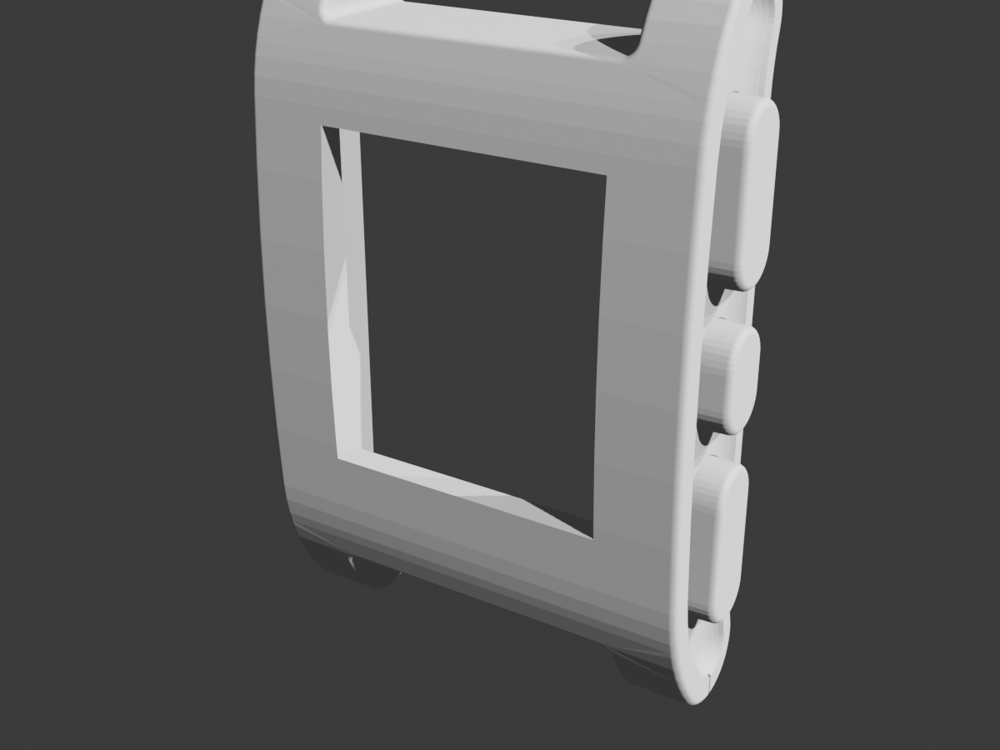

# Giant Pebble Classic Wall Clock (91Dub Edition)

Transform an unmodified **Barnes & Noble Nook Simple Touch** (model `BNRV300`, 6.0" E-Ink Pearl display) into a wall-mounted digital clock modeled after the iconic **Pebble Smartwatch** running the classic **91Dub** watchface (originally created by `orviwan`).

<p align="center">
  
  
</p>

---

## Highlights

* **Authentic Factory CAD Unibody:** Scaled directly from Pebble Technology Corporation's official 2013 factory CAD release (`PebbleSolid-20130102.STL`). Features the exact iconic curved crystal curvature, side button profiles, and lug geometry scaled by $4.314\times$.
* **Zero Device Disassembly:** Drop-in rear cavity ($128.5 \times 167.0 \times 38.0\text{ mm}$) securely holds the unmodified Nook Simple Touch with a $10.2\text{ mm}$ retaining bezel and bottom micro-USB power channel.
* **Authentic 91Dub Watchface:** Pixel-perfect recreation derived directly from the original Pebble C source code and 1-bit bitmap assets by the original author (`orviwan`).
* **Integer Scaled for E-Ink Pearl:** Pebble's native $144 \times 168\text{ px}$ canvas is integer-scaled $4\times$ ($576 \times 672\text{ px}$), centering into the Nook's $600 \times 800$ Pearl E-Ink display with 0 subpixel blur.
* **100% Offline Single-File Dashboard:** `dashboard/index.html` embeds all 72 authentic bitmaps as base64 data URIs. No Wi-Fi or server required—runs completely offline from `file:///sdcard/clock/index.html`.
* **Engineered for Android 2.1 (Eclair):** Written in strict ES3/ES5 JavaScript for seamless compatibility with legacy Android 2.1 WebKit and Opera Mini.
* **E-Ink Pearl Optimizations:**
  * **Minute-aligned ticking:** Wakes up on exact `:00` seconds in standard mode to eliminate CPU wakeups.
  * **Anti-ghosting waveform reset:** Built-in high-contrast invert cycle every 30 minutes (or on tap) to wipe residual E-Ink particle shadows.
  * **Interactive touch zones:** Tap the top edge to open settings (12H/24H, Seconds, Blink, Invert, Pebble logo); tap the bottom edge for a manual screen clear.

---

## Repository Structure

```text
Bug91Dub/
├── README.md                           # Master project guide
├── LICENSE                             # Dual license (MIT for code, CC BY-NC-SA 4.0 for CAD)
├── docs/
│   └── CONVERTING_WATCHFACES.md        # Complete guide to converting other Pebble watchfaces
├── tools/
│   └── extract_pbw.py                  # Utility to unpack .pbw files & convert bitmaps to base64
├── dashboard/                          # 91Dub E-Ink Clock Web Dashboard
│   ├── index.html                      # 100% self-contained single-file clock (embedded assets)
│   ├── index.dev.html                  # Development version linking external assets
│   ├── css/
│   │   └── style.css                   # High-contrast e-ink layout & pixelated styling
│   ├── js/
│   │   └── clock.js                    # ES3/ES5 clock engine (time, battery, invert, ghosting)
│   └── assets/
│       ├── embedded_assets.js          # Base64 data URI map of all 72 original assets
│       └── images/                     # Authentic 144x168 Pebble 91Dub PNG images
├── cad/                                # 3D Print Enclosure & Master CAD
│   ├── PRINTING_GUIDE.md               # Slicing parameters, bed orientation & assembly guide
│   ├── giant_pebble_wall_clock.blend   # Master Blender 5.2 CAD scene with textures & hierarchy
│   ├── images/                         # Visual inspection & cross-section renders
│   └── stls/                           # Production-ready, watertight STLs
│       ├── pebble_clock_body_PRINT_READY.stl        # Pre-oriented hollow body (0 non-manifold edges)
│       ├── pebble_clock_back_cover_PRINT_READY.stl  # Flat back cover with dual keyholes & USB notch
│       ├── pebble_clock_strap_top.stl               # Authentic factory trimmed strap stub
│       ├── pebble_clock_strap_bottom.stl            # Authentic factory trimmed strap stub
│       ├── pebble_clock_full_assembly.stl           # Full reference assembly for CAD inspection
│       └── pebble_clock_body_PRINT_READY.3mf        # Bambu Studio / OrcaSlicer project (0.4mm nozzle)
├── nook_setup/                         # Nook Simple Touch configuration & scripts
│   ├── GUIDE.md                        # Step-by-step rooting & setup guide
│   └── scripts/
│       ├── push_clock.sh               # One-click ADB transfer of clock to /sdcard/clock/
│       └── setup_adb.sh                # Display timeout and stay-awake configurator
└── server/                             # Optional local server hosting
    ├── server.py                       # Standalone Python HTTP server with e-ink no-cache headers
    └── docker-compose.yml              # Turnkey Docker Compose configuration for homelabs
```

---

## 3D Printing the Enclosure

Detailed layer heights, wall settings, material recommendations, and bed placement are documented in the **[3D Printing & Assembly Guide](cad/PRINTING_GUIDE.md)**.

### Quick Parts Summary

| Part | File | Dimensions | Recommended Settings |
| :--- | :--- | :--- | :--- |
| **Clock Body** | [`cad/stls/pebble_clock_body_PRINT_READY.stl`](cad/stls/pebble_clock_body_PRINT_READY.stl) | $154.0 \times 48.4 \times 222.1\text{ mm}$ | 0.20mm layer height, 3–4 walls (Arachne), 15% Gyroid infill, Tree supports (build plate only) |
| **Back Cover Plate** | [`cad/stls/pebble_clock_back_cover_PRINT_READY.stl`](cad/stls/pebble_clock_back_cover_PRINT_READY.stl) | $128.0 \times 2.5 \times 166.5\text{ mm}$ | 0.20mm layer height, 100% solid, flat on bed |
| **Top Strap Stub** | [`cad/stls/pebble_clock_strap_top.stl`](cad/stls/pebble_clock_strap_top.stl) | $94.9 \times 19.4 \times 34.7\text{ mm}$ | 0.20mm layer height, Matte Black PLA or 95A TPU |
| **Bottom Strap Stub** | [`cad/stls/pebble_clock_strap_bottom.stl`](cad/stls/pebble_clock_strap_bottom.stl) | $94.9 \times 19.4 \times 34.7\text{ mm}$ | 0.20mm layer height, Matte Black PLA or 95A TPU |

> **Bed Compatibility:** The pre-oriented body is $222.1\text{ mm}$ tall and fits standard $220 \times 220\text{ mm}$ beds (Ender 3, Prusa MK3/MK4) placed at a $45^\circ$ diagonal, or fits straight on $256 \times 256\text{ mm}$ beds (Bambu Lab A1, P1P, P1S, X1C, Creality K1).

---

## Converting Other Pebble Watchfaces

Want to run *Simplicity*, *Text Watch*, *DIN Time*, or your own custom Pebble watchface on the wall clock? 

Check out the **[Watchface Conversion Guide](docs/CONVERTING_WATCHFACES.md)** for:
* Extracting 1-bit monochrome bitmaps and font glyphs from `.pbw` files using `tools/extract_pbw.py`.
* Integer scaling ($4\times$) algorithms.
* ES3/ES5 JavaScript rules for legacy Android 2.1 WebKit.
* E-Ink ghosting mitigation techniques and a complete boilerplate template.

---

## Software Deployment

### Option A: Zero-Network Offline Mode (Recommended)
Because `dashboard/index.html` has zero external dependencies, you can run it completely disconnected from the network:

1. Connect your rooted Nook via USB or ADB over Wi-Fi.
2. Push the standalone file:
   ```bash
   ./nook_setup/scripts/push_clock.sh
   ```
3. Open `file:///sdcard/clock/index.html` in Opera Mini or the stock browser.
4. Set the browser to **Full Screen** mode.

### Option B: Local Network Server
Run the lightweight server on a Raspberry Pi or homelab server:

```bash
# Using Python (zero dependencies)
python3 server/server.py 8080

# Or using Docker Compose
docker compose -f server/docker-compose.yml up -d
```

Navigate to `http://<SERVER_IP>:8080/` in the Nook's browser.

---

## Licensing & Attribution

* **Software Code (`dashboard/`, `server/`, `tools/`, `nook_setup/`):** Licensed under the **[MIT License](LICENSE)**. © 2026 Jon Barlow (`orviwan`) and contributors. Original 91Dub watchface design and assets copyright Jon Barlow.
* **3D CAD Models & Enclosure (`cad/`):** Licensed under **[CC BY-NC-SA 4.0](LICENSE)**. Derived from the official 3D CAD drawings released by **Pebble Technology Corporation** in the [`pebble/pebble-3d`](https://github.com/pebble/pebble-3d) repository (© 2013–2016 Pebble Technology Corporation, All Rights Reserved).
* **Trademarks:** Pebble, Pebble Classic, and Pebble Time are trademarks formerly of Pebble Technology Corporation, subsequently acquired by Fitbit LLC / Google LLC. This project is an independent open-source hardware homage and fan preservation project.
