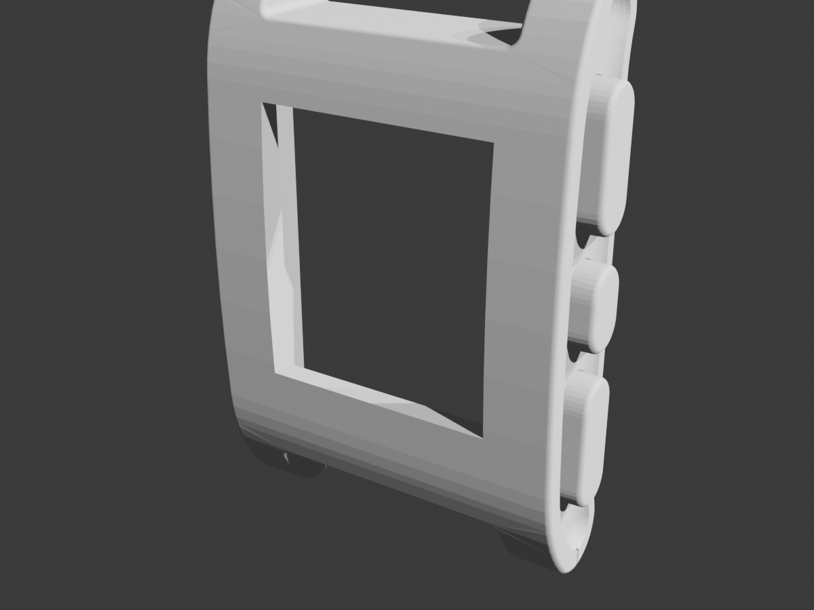
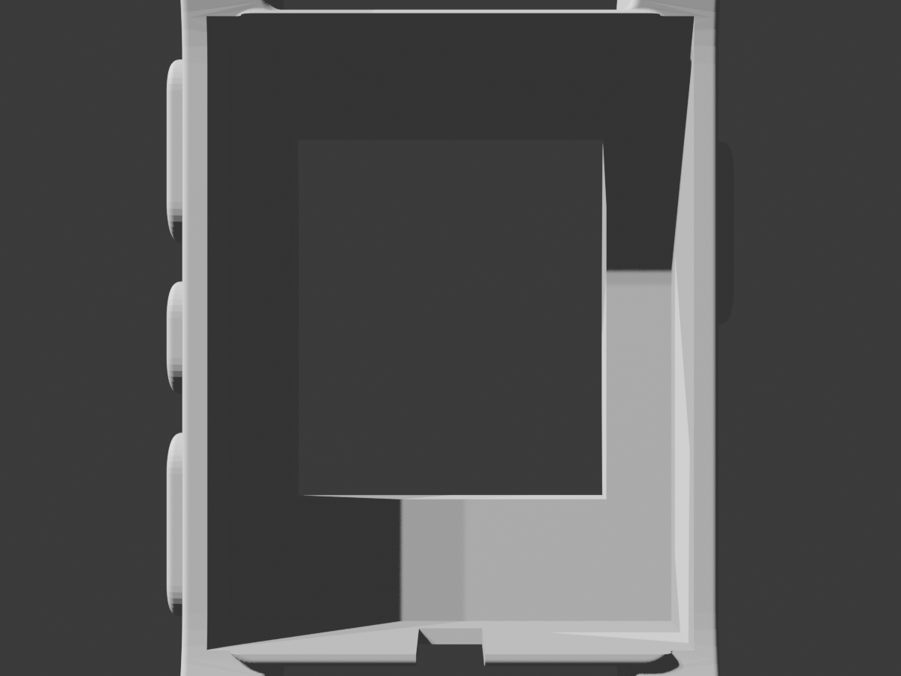

# Giant Pebble Classic Wall Clock — 3D Printing & Assembly Guide

This guide details the complete 3D printing, slicing specifications, and hardware assembly workflow for the Giant Pebble Classic Wall Clock, designed to house an unmodified **Barnes & Noble Nook Simple Touch** (model `BNRV300`) running the iconic Pebble **91Dub** watchface.

---

## 1. Visual Verification & Cavity Architecture

<p align="center">
  
  
  
</p>

### Verified Engineering Dimensions
* **Screen Aperture**: Unobstructed **$90.6 \times 105.7\text{ mm}$** through-window matches the authentic Pebble Classic $144 \times 168$ screen proportions ($1:1.167$).
* **Internal Rear Pocket**: **$128.5 \times 167.0 \times 38.0\text{ mm}$** pocket accommodates the unmodified Nook Simple Touch ($127.0 \times 165.0 \times 12.0\text{ mm}$) with $1.5\text{ mm}$ clearance and retaining lip.
* **Front Retaining Bezel**: **$10.2\text{ mm}$** thick perimeter ledge holds the Nook firmly from the front while framing the active E-Ink display area.
* **USB Pass-through**: **$18.0 \times 45.0\text{ mm}$** bottom cable channel accommodates standard and low-profile right-angle micro-USB cables for permanent wall power.
* **Watertight Mesh**: **0 non-manifold edges** across all printable STLs.

---

## 2. Printable Components Overview

The assembly is divided into 4 modular, watertight, production-ready parts:

| Component | Dimensions ($X \times Y \times Z$) | File Link | Print Time Est. | Material Recommendation |
| :--- | :--- | :--- | :--- | :--- |
| **Clock Body** | $154.0 \times 48.4 \times 222.1\text{ mm}$ | [`pebble_clock_body_PRINT_READY.stl`](stls/pebble_clock_body_PRINT_READY.stl) | $\sim 8\text{--}11\text{ hrs}$ | Black PLA, PLA Pro, or PETG |
| **Back Cover Plate** | $128.0 \times 2.5 \times 166.5\text{ mm}$ | [`pebble_clock_back_cover_PRINT_READY.stl`](stls/pebble_clock_back_cover_PRINT_READY.stl) | $\sim 1\text{--}1.5\text{ hrs}$ | Black PLA or PETG |
| **Top Strap Stub** | $94.9 \times 19.4 \times 34.7\text{ mm}$ | [`pebble_clock_strap_top.stl`](stls/pebble_clock_strap_top.stl) | $\sim 2\text{--}3\text{ hrs}$ | Matte Black PLA or 95A TPU |
| **Bottom Strap Stub** | $94.9 \times 19.4 \times 34.7\text{ mm}$ | [`pebble_clock_strap_bottom.stl`](stls/pebble_clock_strap_bottom.stl) | $\sim 2\text{--}3\text{ hrs}$ | Matte Black PLA or 95A TPU |
| **Full Reference Assembly** | $154.0 \times 48.4 \times 273.4\text{ mm}$ | [`pebble_clock_full_assembly.stl`](stls/pebble_clock_full_assembly.stl) | *(Reference)* | Slicer CAD Inspection |

---

## 3. Print Bed Orientation & Slicing Settings

### A. Clock Body (`pebble_clock_body_PRINT_READY.stl`)
* **Bed Placement**: Pre-oriented **flat on its back surface** directly on the build plate ($Z=0$).
* **Bed Compatibility**: 
  * Fits standard $220 \times 220\text{ mm}$ beds (Ender 3, Prusa MK3/MK4) placed at a $45^\circ$ diagonal.
  * Fits straight on $256 \times 256\text{ mm}$ beds (Bambu Lab A1, P1P, P1S, X1C, Creality K1, etc.).
* **Layer Height**: **$0.20\text{ mm}$ Standard** (or $0.16\text{ mm}$ Optimal for extra barrel curve smoothness).
* **Walls / Perimeters**: 3 to 4 walls ($1.2\text{--}1.6\text{ mm}$ shell thickness).
* **Wall Generator**: **Arachne** (dynamically adjusts extrusion width to fill thin walls without gaps).
* **Infill**: $15\%\text{--}20\%$ Gyroid (avoid Grid infill to prevent nozzle collisions at high print speeds).
* **Nozzle Temperature (Hardened Steel Nozzle)**: $220^\circ\text{C}\text{--}225^\circ\text{C}$ for standard PLA.
* **Bed Temperature**: $60^\circ\text{C}\text{--}65^\circ\text{C}$ on Textured PEI plates.
* **Supports**:
  * Set support type to **Tree / Organic Supports (Build plate only)**.
  * Only light tree supports are needed beneath the side button overhangs and the top bridge of the display window aperture.
  * The front curved crystal face prints facing upward into open air with zero supports touching it, guaranteeing a flawless surface finish.

### B. Back Cover Plate (`pebble_clock_back_cover_PRINT_READY.stl`)
* **Bed Placement**: Flat on the build plate.
* **Layer Height**: $0.20\text{ mm}$.
* **Infill**: $100\%$ solid (only 12--13 layers thick).
* **Features**: Includes $2\times$ standard teardrop keyhole wall-hanger slots (one high, one center) and bottom USB cable exit.

### C. Strap Stubs (`pebble_clock_strap_top.stl` & `bottom.stl`)
* **Bed Placement**: Flat on the planar cut face.
* **TPU Option**: Printing these in 95A flexible TPU gives them an authentic matte silicone watchband texture.

---

## 4. Hardware Assembly Steps

```text
[Wall Screws] <--- [Back Cover w/ Keyholes] <--- [Nook Simple Touch] <--- [Clock Body]
                                                         |
                                                  [Micro-USB Cable]
```

1. **Test Fit**:
   * Slide the Nook Simple Touch (face forward) into the rear cavity ($128.5 \times 167.0\text{ mm}$) of the clock body.
   * Verify that the active E-Ink Pearl display aligns squarely with the front $90.6 \times 105.7\text{ mm}$ window.
2. **Connect Power**:
   * Plug a micro-USB charging cable into the bottom port of the Nook Simple Touch.
   * Route the cable downward through the bottom cable relief channel.
3. **Attach Back Cover**:
   * Drop the back cover into the rear recess.
   * Secure with $4\times$ small M3 $\times 8\text{ mm}$ counter-sunk screws (or high-bond double-sided tape/friction fit).
4. **Attach Straps**:
   * Press `Strap_Top` and `Strap_Bottom` into their respective lug recesses. Secure with a drop of CA glue or friction fit.
5. **Mount to Wall**:
   * Drive one or two standard #6 or #8 drywall screws into your wall, leaving $3\text{ mm}$ of the head protruding.
   * Align the keyhole slots on the back cover over the screw heads and slide down to lock securely.
